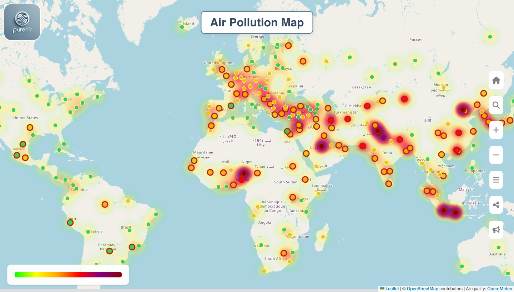

# PureAir



Real-time air quality monitoring platform. PureAir collects hourly PM2.5, PM10, NO2, SO2 and O3 data for 239 cities worldwide, detects anomalies and presents the results on an interactive map, in trend charts and as live notifications.

Developed by **Bilal Kutluca** ([@bilalkutluca](https://github.com/bilalkutluca)) and **Busenur Kutluca** ([@busenurkutluca](https://github.com/busenurkutluca)).

## Features

- **Global map:** pollution heat layer and city markers colored by PM2.5 level
- **Trend analysis:** hourly averages for the last 3 days, worldwide or for a selected city
- **Anomaly detection:** threshold-based checks with live notifications over WebSocket
- **Regional analysis:** city search and a detailed view with charts and anomaly history

## Architecture

A scheduled collector fetches air quality data from the Open-Meteo API every hour and publishes it to Apache Kafka. A Kafka consumer checks each measurement for anomalies, stores it in TimescaleDB and pushes anomalies to connected clients over WebSocket. The React frontend reads the data through a REST API. All services run in Docker containers managed by Docker Compose.

## Tech Stack

| Area | Technologies |
| --- | --- |
| Backend | Java 17, Spring Boot 3, Spring Data JPA, WebSocket |
| Data | Apache Kafka, TimescaleDB (PostgreSQL) |
| Frontend | React, Vite, Leaflet, Recharts |
| Infrastructure | Docker, Docker Compose |

## Getting Started

### Prerequisites

- Docker and Docker Compose
- An [OpenWeatherMap](https://openweathermap.org/api) API key (used for the weather widget on the home page)

### Installation

1. Clone the repository:

   ```bash
   git clone https://github.com/bilalkutluca/PureAir.git
   cd PureAir
   ```

2. Create the environment files from the examples and fill in the values:

   ```bash
   cp backend/.env.example backend/.env
   cp pureair/.env.example pureair/.env
   ```

3. Start the services:

   ```bash
   cd backend
   docker compose up -d
   ```

The frontend runs at http://localhost:5173 and the backend at http://localhost:8081. Data collection starts automatically shortly after the backend is up.

## Data Sources

- Air quality: [Open-Meteo Air Quality API](https://open-meteo.com/en/docs/air-quality-api)
- Map tiles and geocoding: [OpenStreetMap](https://www.openstreetmap.org/)
- Weather: [OpenWeatherMap](https://openweathermap.org/)
